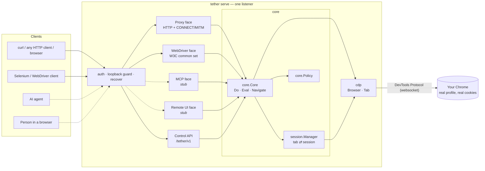
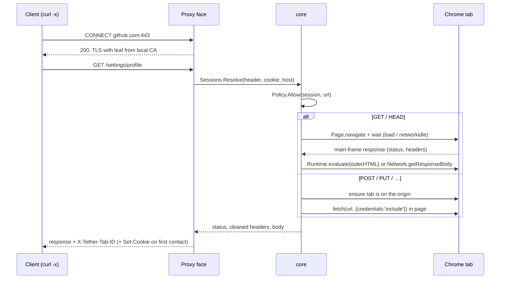

# Architecture: four faces on one core

Tether is one small engine — *a request, in a real tab, of a real logged-in
Chrome* — with several protocol "faces" in front of it. The faces are
deliberately thin. Everything that touches the browser, decides which tab a
request belongs to, or says whether a request is allowed lives in the core,
so every face behaves the same way and new faces are cheap.

## Packages

| Package | Role |
|---|---|
| `cmd/tether` | CLI: `serve`, `ca`, `version`. Parses config, wires logging and signals. |
| `internal/app` | Assembles a running Tether from a `Config`: Chrome, core, faces, server. Used by the CLI and the integration tests. |
| `internal/cdp` | The only package that speaks CDP. `Browser` and `Tab` interfaces; `Chrome` implementation over a single flattened websocket; endpoint discovery and `Launch`. `cdptest` holds fakes. |
| `internal/session` | `Session` = one page target. `Manager` resolves requests to sessions, opens/adopts/closes tabs, reaps idle ones, and serialises work per tab. |
| `internal/core` | `Core.Do` (execute an HTTP request in a tab), `Eval`, `Navigate`, the `Policy` seam, header hygiene, and error classification shared by HTTP faces. |
| `internal/proxy` | Forward-proxy face. Plain HTTP and CONNECT with TLS interception via `internal/certs`. |
| `internal/webdriver` | W3C WebDriver face (see [WEBDRIVER.md](WEBDRIVER.md)). |
| `internal/api` | Control plane: health, tabs, eval, CA download. |
| `internal/server` | Listener, routing, token auth, loopback guard, graceful shutdown, exposure checks. |
| `internal/mcp`, `internal/remote` | Planned faces, mounted and answering `501` today. |
| `internal/certs`, `internal/logx`, `internal/config`, `internal/version`, `internal/httpx` | Supporting pieces. |

## The session model

A **session is exactly one Chrome tab** (a CDP page target), keyed by its
target ID. That ID is the only handle a client ever needs: it is the
`X-Tether-Tab-ID` header, the `tether_tab` cookie value, the WebDriver
session ID, and the path segment in `/tether/v1/tabs/{id}`. A tab opened by
one face can be driven by any other.

Resolution precedence for proxy requests:

1. **`X-Tether-Tab-ID` header** — explicit. Unknown or closed → `410 tab_gone`.
   An ID of a tab Tether didn't open but which exists in Chrome is *adopted*
   (driven, never auto-closed).
2. **`tether_tab` cookie** — set on first contact, scoped to the registrable
   domain (`Domain=example.co.uk; Path=/`) so a client can hold one per site
   without collisions. A dead cookie → `410` plus a clearing `Set-Cookie`.
   The cookie is stripped before anything reaches the page.
3. **Default tab per registrable domain** — eTLD+1 via the Public Suffix
   List, so `a.example.co.uk` and `b.example.co.uk` share a tab while
   `foo.github.io` and `bar.github.io` do not. First contact opens a fresh
   background tab and returns it as header + cookie.

Lifecycle: tabs Tether opened are closed after `--idle-timeout`, on
`DELETE /tether/v1/tabs/{id}`, on WebDriver `DELETE /session`, and on
shutdown. If the user closes a tab in Chrome, the `Target.targetDestroyed`
event ends the session immediately. Adopted tabs are released, never closed
(unless explicitly forced).

Console capture: when a tab is attached, `cdp` enables the `Runtime` and
`Log` domains and keeps a ring buffer (`--console-buffer`, default 1000) of
`Runtime.consoleAPICalled`, `Runtime.exceptionThrown` and `Log.entryAdded`
events. Every entry carries a per-tab sequence number, so any face can read
"what's new since N" without its own copy: `Core.Logs(session, after,
minLevel)` returns the entries plus the next cursor, and does not take the
tab lock, so logs can be read while a request is running. The control API
(`GET /tether/v1/tabs/{id}/logs`) and WebDriver's `get_log("browser")` are
thin views over it; the MCP face will be another.

Concurrency: each session has a one-slot semaphore; requests to one tab run
one at a time (a tab can only be on one page), different tabs run in
parallel. First-contact creation is de-duplicated per domain, so a burst of
requests for a new site opens one tab, not twenty.

## How a proxied request runs

Header hygiene lives in core: hop-by-hop headers, encodings the browser
already decoded, and `Set-Cookie` never reach the client; client cookies,
proxy auth and Tether control headers never reach the page.

## The four faces

| Face | Status | Consumes |
|---|---|---|
| HTTP proxy | **Shipping** | `Sessions.Resolve`, `Core.Do` |
| WebDriver | **Shipping** | `Sessions.Create/Get/Close`, `Core.Navigate`, `cdp.Tab` primitives |
| MCP server | Stub (`/mcp` → 501) | Will map tools (`navigate`, `read_page`, `click`, `type`, `eval`, `screenshot`, `tabs`) onto the same calls. `core.Policy` becomes per-agent permissions. Streamable HTTP transport on the same listener, so it inherits auth and Tailscale exposure. |
| Remote UI | Stub (`/remote` → 501) | Will stream a tab with `Page.startScreencast` (WebRTC later) and forward input through `cdp.Tab.Click`/`Key`, letting a person watch or take over exactly the tab an agent is driving. |

Every face implements `core.Face` (`Name()` + `http.Handler`) and is mounted
by the server; adding one is a new package and one line in `internal/app`.

## Design choices

- **CDP, no extension.** Tether attaches over the DevTools Protocol, which
  every Chrome already speaks. The tiny `cdp` layer uses go-rod's websocket
  client and our own minimal message types — no high-level framework magic
  (device emulation, implicit waits) touching the user's real tabs.
- **One websocket, flattened sessions.** All tabs share a single browser
  connection; events are fanned out per CDP session.
- **Browser-executed requests.** Navigation for reads gives you the page as
  the user would see it, JavaScript included. `fetch()` for writes keeps
  cookies, CSRF-same-origin semantics and the browser's own network stack.
- **Rendered by default, raw on request.** `X-Tether-Mode: raw` returns the
  original bytes; `fetch` forces an in-page fetch for any method.
- **Fail loudly.** Dead tabs are `410`, navigation errors `502`, timeouts
  `504`, policy denials `403`, with a stable `X-Tether-Error` code.
