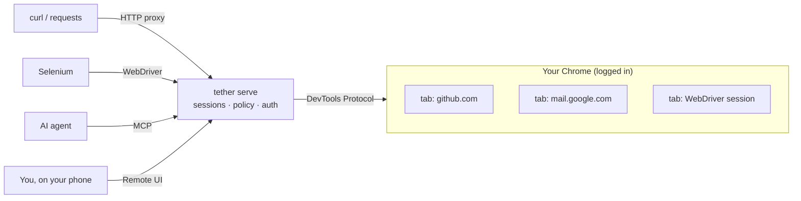

# Your real browser, four ways in

Agents and scripts keep hitting the same wall: the page they need is behind a
login, an SSO dance, a captcha you already solved, or a cookie banner you
already dismissed, **in your browser**. Every tool that bridges into that
browser today asks you to install an extension. **Tether doesn't.** It attaches
to Chrome over the DevTools Protocol Chrome already speaks, and turns each tab
into something any client can use.

<div class="grid cards" markdown>

-   :material-web:{ .lg .middle } **HTTP/HTTPS proxy**

    ---

    `curl -x`, Python `requests`, another browser, anything. Each request is
    replayed inside a real tab: real cookies, real storage, real JavaScript.

    [:octicons-arrow-right-24: Proxy guide](proxy.md)

-   :material-robot-outline:{ .lg .middle } **MCP server for agents**

    ---

    Claude, Cursor or your own agent get tools to read, click, type,
    screenshot and fetch in your signed-in browser.

    [:octicons-arrow-right-24: Connect an agent](MCP.md)

-   :material-language-python:{ .lg .middle } **W3C WebDriver**

    ---

    Point Selenium at Tether and most scripts just work, against your actual
    profile. Frames, alerts, windows, uploads and Actions included.

    [:octicons-arrow-right-24: WebDriver support](WEBDRIVER.md)

-   :material-monitor-eye:{ .lg .middle } **Live remote UI**

    ---

    Open `/remote/` from your phone, watch any tab live, and take over with
    mouse, keyboard and clipboard, even the tab your agent is driving.

    [:octicons-arrow-right-24: Remote browser](REMOTE.md)

-   :material-shield-lock-outline:{ .lg .middle } **Safe by default**

    ---

    Loopback-only unless you set a token. Per-agent tokens with domain rules
    enforced inside the browser. Built for a private Tailscale tailnet.

    [:octicons-arrow-right-24: Security model](security.md)

-   :material-package-variant-closed:{ .lg .middle } **One static binary**

    ---

    No extension, no cloud service, no local bridge. macOS, Linux, Windows
    and a Docker image with headless Chromium.

    [:octicons-arrow-right-24: Install](getting-started.md)

</div>

## Try it in 30 seconds

```sh
go install github.com/adeelahmad/tether/cmd/tether@latest
tether serve --launch            # log in to GitHub once in the window it opens

curl -s http://127.0.0.1:8787/tether/v1/ca.pem -o tether-ca.pem
curl -s -x http://127.0.0.1:8787 --cacert tether-ca.pem https://github.com/settings/profile \
  | grep -o '<title>[^<]*</title>'
```

You get your profile settings page, the one that redirects to a login screen
for everyone else. [Full quickstart :octicons-arrow-right-24:](getting-started.md)

## How it works



**One session = one real tab.** Every face shares the same tab sessions, the
same policy checks and the same auth, so a proxy client, a Selenium script and
an agent can all work in the same tab. Read the
[architecture](ARCHITECTURE.md) for the details.

## How Tether compares

Tether's trade-off is that HTTPS proxying needs you to trust a local CA, and it
only drives Chromium-family browsers.

| | **Tether** | Extension-based bridges | Cloud browsers | Fresh headless automation |
|---|---|---|---|---|
| Uses your real logged-in profile | ✅ | ✅ | ❌ | ❌ |
| Needs a browser extension | **No** | Yes | No | No |
| Plain HTTP proxy (curl, any language) | ✅ | ❌ | Rarely | ❌ |
| W3C WebDriver / Selenium | ✅ | ❌ | Often | ✅ |
| MCP for agents | ✅ | Often | Often | Via wrappers |
| Runs entirely on your machine | ✅ | ✅ | ❌ | ✅ |
| Watch & take over a tab live | ✅ | ❌ | ✅ | ❌ |
| Single static binary | ✅ | ❌ | n/a | ❌ |
